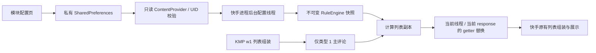

# 设计方案

## 用户已确认的需求

| 项目 | 约定 |
| --- | --- |
| 目标 | 普通快手 `com.smile.gifmaker`，所提供 APK 的 14.9.20.50799 版本 |
| 设备环境 | Android 16、LSPosed 2.1.0；用户已确认 0.1.2 功能完全可用 |
| 字段 | 评论 IP 属地、评论内关键词、作者性别 |
| 黑白名单 | 两个互斥模式，选定其一后只执行该名单 |
| 评论层级 | 只过滤主评论 |
| 缺失信息 | 允许显式匹配未知属地和未知性别 |

## 首版规则语义

以下是本工程的规则语义，配置校验与快手内过滤使用相同引擎：

1. 关闭总开关时保留所有评论。
2. 回复始终不参与判定；特殊卡片和不能正确读取的对象保留。
3. 黑名单模式：命中任一启用黑名单规则则隐藏，否则保留。白名单不参与判定。
4. 白名单模式：命中任一启用白名单规则则保留，否则隐藏。黑名单不参与判定。
5. 没有有效白名单规则时保留全部，防止空配置导致评论区全部消失。

同一规则内，属地、关键词、性别三个字段之间是 AND；一个字段中的多个候选值是 OR；不同规则之间是 OR。空数组表示不限制该字段，完全没有条件的规则不能保存。

例如，要隐藏“广东作者，并且正文含推广”的评论，把两项条件写在同一条规则。要隐藏“广东作者，或者正文含推广”的评论，创建两条规则。

| 字段 | 匹配方式 |
| --- | --- |
| 属地 | Unicode NFKC、首尾空白清理、去除 `IP属地` / `IP 属地` / `发布于` / `发表于` 前缀及冒号，然后精确匹配 |
| 关键词 | Unicode NFKC 后进行字面包含；默认英文大小写不敏感，可关闭；不支持正则 |
| 性别 | 快手用户字段 `M`、`F`；其他值、字段为空或没有用户对象归为 `UNKNOWN` |
| 未知属地 | 标准化后为空，且规则 `unknownLocation=true` 时匹配 |

“广东”和“广东省”不会自动合并；未匹配到普通属地或性别条件的未知值不会被当作命中。读取接口出错属于适配失败，该评论整体保留，不把接口异常伪装成未知信息。

JSON `schemaVersion=1`；规则 ID 在两份名单中全局唯一。最多 500 条规则，每个字段最多 100 个值，JSON 最多 262144 字符。未知字段、非法类型、无条件规则均拒绝保存。inactive 名单仍校验结构，但不参与评论判定。

## 架构

### Xposed 与版本适配

使用传统 Xposed API 82（`compileOnly`，不打包进 APK），通过 `assets/xposed_init` 注册入口。仅在快手主进程 `Application.attach` 后读取宿主身份，精确匹配版本名和 versionCode 后安装适配器。

首版 Hook `KmpCommentFeaturePageList.w1(w2b.q)`，此方法读取 `response.getKLocalComments()` 并组装本地完整列表。前序 `i1(...)` 将主评论标为类型 1、回复标为类型 2。因此适配层只读取 `dpb.d` 实例且 `getKType()==1 && !getKIsSub()` 的对象。

不修改服务端响应字节、分页 cursor、hasMore、服务器评论总数或楼中楼 Map。首次遇到具体 response 类型时，解析并 Hook 它的 `getKLocalComments()` 实现。在 `w1` 前计算副本，利用 ThreadLocal 仅在当前 response、当前组装调用内返回副本；组装完成（包括异常退出）后恢复上层作用域。普通 getter 读取仍返回原列表。没有任何过滤结果时不创建副本。

这样不会永久删除缓存中的原评论，修改规则后的新一轮组装仍有机会恢复。已有展示列表仍需刷新；仅关闭开关不会主动重绘快手界面。

此策略的实际效果依赖运行时仍调用该方法及 getter。内联优化、Robust 热补丁、不同实验分流或另外一套评论路径可能绕过它，必须真机确认。首版不使用未经定位的全局 Gson/RecyclerView Hook 作为兜底。

### 配置同步

模块 UI 先用规则引擎验证，再后台原子提交 JSON 和递增 revision，之后发送 `notifyChange`。只读 Provider 只允许模块自身 UID、属于 `com.smile.gifmaker` 的 UID 读取，所有写接口拒绝调用；不使用 world-readable 文件。

快手端在独立 HandlerThread 注册观察者、查询和编译配置，成功后一次替换 volatile 引擎快照。列表回调只读快照，并最多每 5 秒安排一次后台补查。观察者失败不会中断后续补查。启动时默认禁用；刷新失败保留最后有效快照；不输出配置内容或评论正文。

### 配置应用与诊断

“保存成功”只表示模块本地提交成功。界面不会把该状态标为“已注入”。LSPosed 日志提供版本不支持、适配符号不可用、规则加载 revision 和累计列表处理/隐藏次数；隐藏次数是处理次数，可能重复计算同一评论，不代表唯一用户数。

### 0.1.1：不足一屏与空页补充加载

用户反馈过滤后只剩少量评论或完全为空，无法滚动触发续页。0.1.0 虽然能拦截后续页，但没有解决“下一页根本无法触发”的情况；列表长度还参与宿主的折叠逻辑。本修订保留原有过滤语义，补充续载协调器，不强制改写分页标志。

静态确认 `KMPPageList.q(KMPPageList$c)` 成功处理时先计算宿主 `hasMore`，提交当前 response/cursor，最后调用 `u(false)` 结束加载。模块只对已经见过的快手评论实例，在此方法返回后安排主线程补页；不在 `w1` 的解析过程中递归调用加载。

满足以下条件才补页：规则已启用且本会话确实过滤过评论；可见主评论未达到目标，或新页没有新增可见主评论；宿主仍有更多、没有正在加载、没有登录锁；同一 Activity 仍在前台且会话未被替换。目标按屏幕高度和保守行高估计，最少 12、最多 60 条主评论，不是精确测量 RecyclerView 高度。标题、卡片和回复不计入。

每轮最多自动请求 5 页，之后等待用户手动继续。0.1.1 使用提示框；0.1.2 已替换为下一节描述的底部按钮。已有列表足够且新页新增主评论时回到原生滚动加载。

通过 `owner.k()` 调用宿主 `c1.load()`，保持游标、末尾、错误和登录锁语义；自动发起的调用带内部标记，避免被误认成外部加载而重置预算。重复/回环游标停止；失败、取消、刷新或释放实例使会话失效。Activity 暂停时撤销排队任务和手动继续控件，保留尚未发出的动作；同一 Activity 恢复时重新调度，不重复消耗预算。所有延迟任务携带会话票据；会话仅弱引用宿主和 response。

同一 Activity 内面板关闭是否调用宿主取消/释放事件，以及 ART 内联/热补丁能否影响新增 Hook，仍需设备验证。不会绕过宿主错误或登录限制继续请求。

### 0.1.2：评论列表底部按钮

`CommentFooterController` 通过父类 `RecyclerFragment.j0()` 识别 `AbsCommentsFragment` 的实际列表。具体 `CommentsFragment` 位于 APK 内嵌的 `assets/dva_feature/comment_detail-master.zip` 插件中；Hook 父类即可接收运行时子类，不提前加载插件实现。

优先比较 Fragment 当前分页 response 与模块会话 response 的对象身份，并校验视频 ID。已知响应冲突直接排除；没有可比较响应时只接受唯一可见的同视频候选。通过 `pcl.f.Q1(View)` 添加原生页脚、`E2(View)` 删除，未修改 RecyclerView adapter 的主评论数量。未找到合适面板时只记录日志并等待就绪，不回退到弹窗。

按钮在等待继续时出现，点击后禁用并显示“加载中…”，同一按钮在下一轮等待时更新动作和票据并重新启用。原生布局因新增页脚触发的自动预加载在等待手动继续阶段被暂缓，防止绕过自动请求上限。面板暂停、取消选择、销毁或不可见时移除按钮；适配器更换或原生移除页脚后重新绑定。绑定有独立 token，旧页脚延迟回调不会关闭新绑定。

静态边界：宿主若启用独立 footer adapter（`pcl.f.h` 非空），普通 footerViews 会被覆盖，首版按钮适配不写入该位置。宿主 `isEmpty()` 只检查主 adapter，不能从静态证据保证空态不会遮盖页脚。完全空列表和插件热更新属于真机重点验收项。

## 交付与后续边界

当前交付 0.1.6 工程和 Debug APK、规则配置页、56 项测试和静态证据。用户已确认 0.1.2 功能完全可用。历史界面整理见 [配置界面整理](UI_0.1.3.md)；当前版本只在点击“保存规则”时提交配置，移除底部状态文字；草稿与保存快照分离，后台保存结果不会覆盖之后的编辑。

真机验收通过后，再根据实际差异增加新适配器或补充其他确证路径。本工程不处理直播、弹幕、私信、个人主页评论集合、搜索评论集合，不主动请求作者个人资料、不推断性别。
